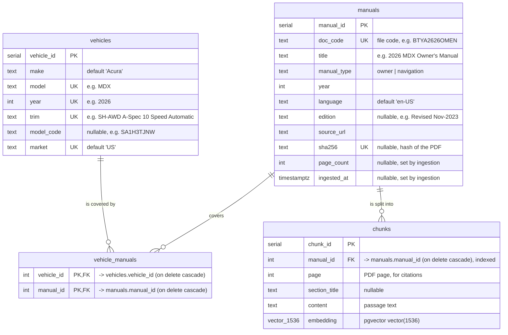

# Database schema

The PostgreSQL tables defined in [`src/prisma/contract.prisma`](../../src/prisma/contract.prisma) and created by the migrations in [`migrations/`](../../migrations).



**Legend**

| Mark | Meaning |
|---|---|
| **PK** | Primary key: uniquely identifies each row of the table. `vehicle_manuals` has two PK columns: the pair is unique, so each vehicle–manual link appears once. |
| **FK** | Foreign key: holds the PK of a row in another table, linking the two (e.g. `chunks.manual_id` → `manuals.manual_id`). "On delete cascade" means deleting that row also deletes the rows pointing to it. |
| **UK** | Unique key: no two rows can share this value. When several columns are marked UK in one table (`year`, `model`, `trim`, `market` in `vehicles`), it's the combination that must be unique. |


- **`vehicles`**: one row per year/model/trim. `year`, `model`, `trim` and `market` together are unique.
- **`manuals`**: one row per unique PDF manual (owner's or navigation; the interactive HTML manuals are not included). Many trims share the same PDF, so each PDF is stored, chunked and embedded once. The local copy of a PDF is `data/acura_manuals/manuals_{year}/raw/{doc_code}.PDF`.
- **`vehicle_manuals`**: links trims to the manuals that cover them (many-to-many). A trim has an owner's manual, and many also have a navigation manual.
- **`chunks`**: one row per searchable passage with its embedding. Searches filter by `manual_id` first, so answers never mix vehicles.

## How the agent uses it

```sql
-- which manuals cover the user's vehicle
SELECT DISTINCT m.manual_id, m.doc_code, m.title, m.manual_type
FROM vehicles v
JOIN vehicle_manuals vm ON v.vehicle_id = vm.vehicle_id
JOIN manuals m ON vm.manual_id = m.manual_id
WHERE v.model = 'MDX' AND v.year = 2026;

-- the 5 passages in that manual closest to the question's embedding
SELECT c.page, c.section_title, c.content
FROM chunks c
WHERE c.manual_id = $1
ORDER BY c.embedding <=> $2
LIMIT 5;
```

`<=>` is pgvector's cosine distance (smaller is closer).

The database also has Prisma's own bookkeeping tables, which record the applied migrations. They're managed by Prisma and not shown here.
